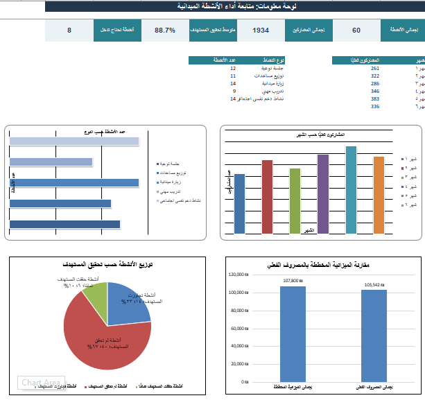

# Field Project Performance Analysis Dashboard

## Project Overview
This project presents an Excel-based dashboard designed to analyze the performance of a simulated field project using sample data.

## Project Objectives
- Analyze field activities and participation rates.
- Monitor target achievement.
- Compare planned and actual budgets.
- Identify performance indicators and areas that may require attention.

## Tools Used
- Microsoft Excel
- Excel Formulas
- Charts and Data Visualization
- Interactive Dashboard

## Key Results
- Total Activities: 60
- Target Participants: 2,205
- Actual Participants: 1,934
- Average Target Achievement: 88.7%
- Planned Budget: 107,800 ILS
- Actual Expenditure: 103,542 ILS
- Budget Savings: 4,258 ILS

## Data Disclaimer
All data used in this project is simulated and created for learning and portfolio demonstration purposes only.
## Dashboard Preview

